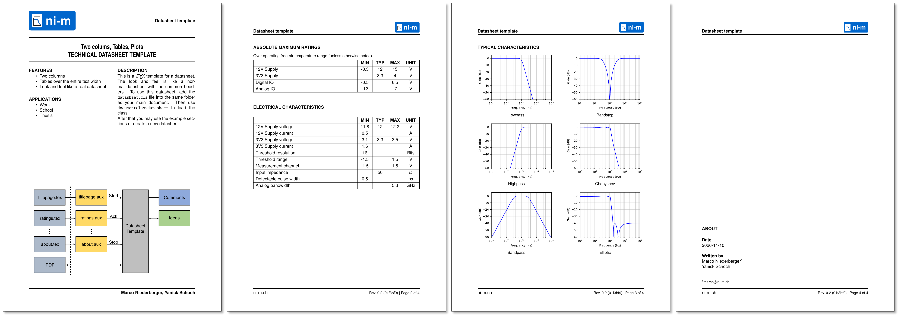

# LaTeX Datasheet Template

[](https://keepachangelog.com/en/2.0.0/)
[](https://semver.org/spec/v2.0.0.html)
[](LICENCE.md)

A LaTeX class for technical datasheets in the style of common datasheets: logo header, two-column feature/description block, specification tables and characteristic plots.



## Features

- Title page with logo, project name, title and subtitle
- Consistent header and footer on all following pages
- Two-column layout for features, applications and description
- Full-width tables for absolute maximum ratings and electrical characteristics

## Quick start

1. Copy datasheet.cls next to your .tex file. Optionally add a logo and set its path with `\logo{...}`.
2. Use the class:

```latex
\documentclass{datasheet}

\title{Two Columns, Tables, Plots}
\subtitle{TECHNICAL DATASHEET TEMPLATE}
\author{Marco Niederberger, Yanick Schoch}
\projectname{Datasheet template}
\revision{1.0}
\logo{images/logo.png}

\begin{document}
\maketitle
...
\end{document}
```

3. Build with your LaTex compiler.

See [`example.tex`](example.tex) for a complete example. The rendered PDF is attached to each [release](../../releases).

## Commands

| Command                        | Description                                  |
|--------------------------------|----------------------------------------------|
| `\title{...}`                  | Main title line                              |
| `\subtitle{...}`               | Second title line (optional)                 |
| `\author{...}`                 | Shown in the footer of the title page        |
| `\projectname{...}`            | Shown in the header of every page            |
| `\footerleft{...}`             | Shown in the left footer of every page       |
| `\logo{...}`                   | Path to logo file                            |
| `\revision{...}`               | Document revision, shown in the footer       |
| `\dsplot[opts]{file}{caption}` | Command to typeset a plot with a caption     |
| `\maketitle`                   | Typesets the title block                     |

## Changelog

See [`CHANGELOG.md`](CHANGELOG.md).

## Contributing

Issues and pull requests are welcome.
Please describe the change, and attach a screenshot or PDF when it affects the layout.

## Preview

Update the overview.png file using the following commands:
```bash
pdftoppm -png -r 150 -l 4 build/example.pdf page
magick montage page-*.png -tile 4x1 -geometry +16+16 -bordercolor black -border 1 -background none -shadow images/overview.png
rm page-*.png
```

## License

[MIT](LICENCE.md) © 2026 Marco Niederberger
